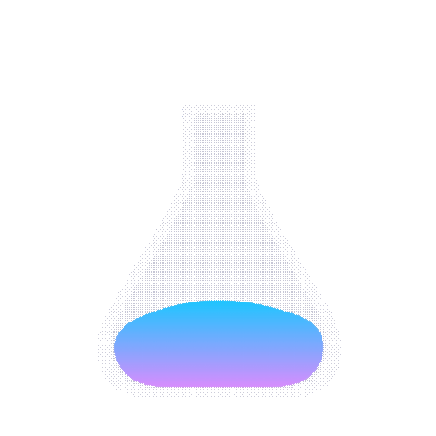
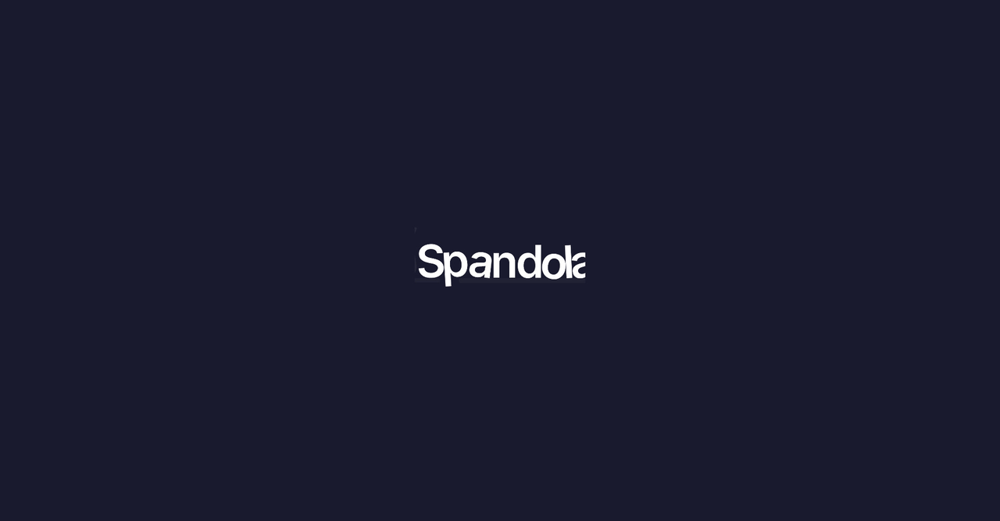
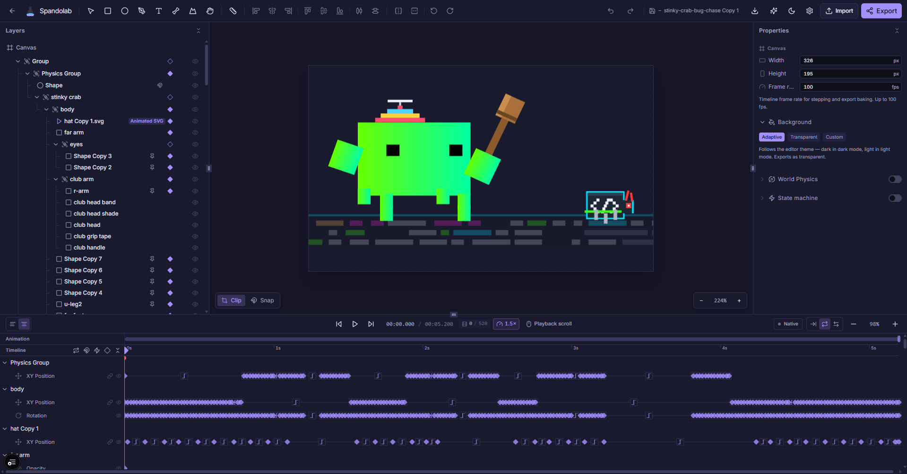
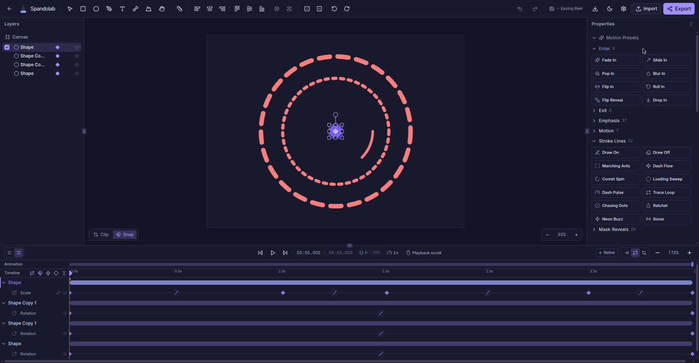
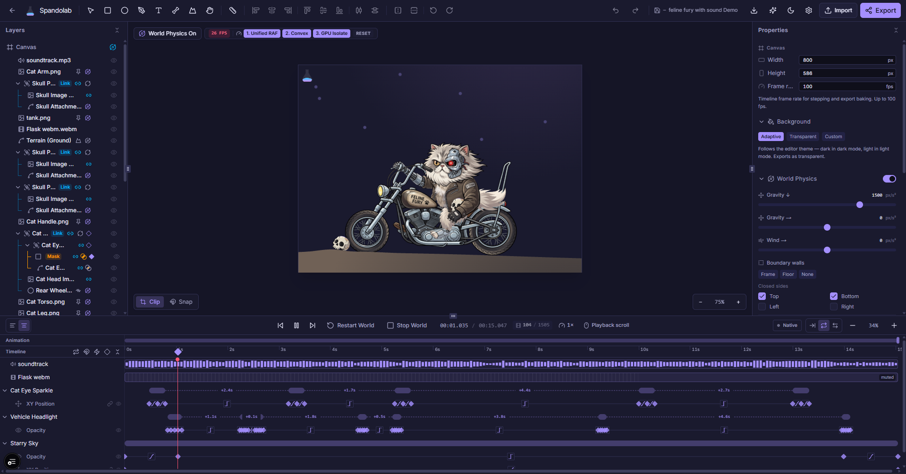
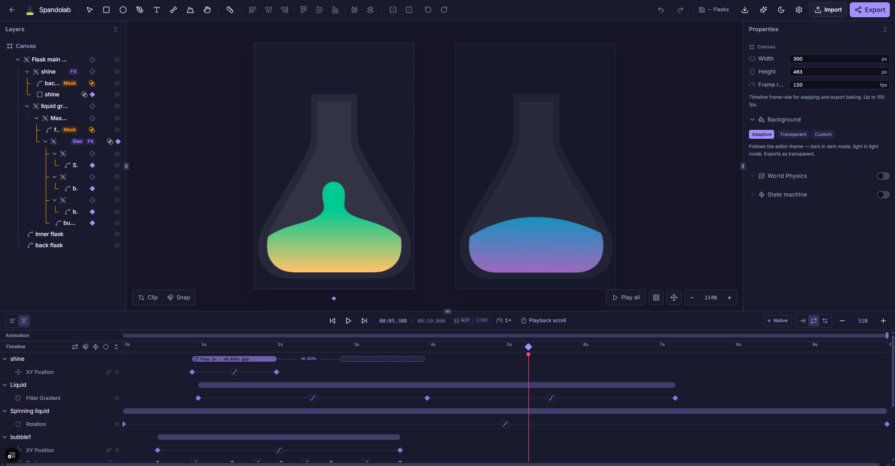
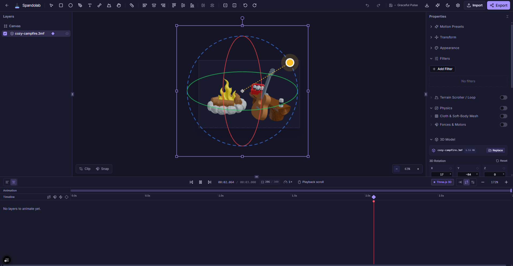
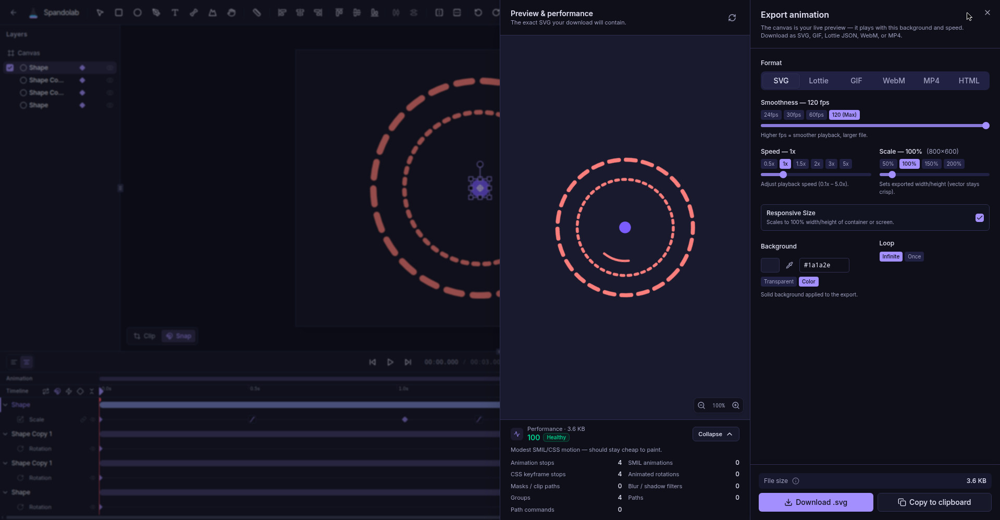

  

<h1 align="center">Spandolab — Free Online 2D Animation Editor</h1>

  <strong>Your personal motion playground: a browser-based keyframe animation editor with a timeline, a real physics engine, dozens of one-click motion presets, and export to Lottie, SVG, GIF, WebM and MP4.</strong>

  <a href="https://www.spandolab.app"><strong>▶ Open Spandolab — www.spandolab.app</strong></a>
   
  No account · No signup · No paywall · Runs entirely in your browser

  <a href="assets/spandolab-demo.mp4"><strong>Watch the demo video</strong></a>

  
   
  <em>Made in Spandolab itself: open the app, play the animation, export a transparent GIF.</em>

---

## What is Spandolab?

Spandolab is a free online 2D animation tool for motion design, web animation, animated illustrations, icons, stickers, banners and interactive prototypes. Draw shapes, text and images on artboards, animate any property over time on the timeline, add physics or effects, and export your animation for the web, apps and social media.

Anyone is welcome to animate with it as well — just open [spandolab.app](https://www.spandolab.app) and start. There is nothing to install and nothing to pay.

## Screenshots

## Key features

- **Keyframe timeline animation** — keyframes, easing curves (including custom cubic-bezier, elastic and bounce), auto-keyframe record mode, and loop tweens with ghost loops, so repeating cycles are animated once instead of duplicated by hand
- **Motion presets** — around 30 one-click animations: Fade In, Pop In, Bounce, Spin, Pulse, Wiggle, Draw On and more, with live preview on your actual object
- **Real physics engine** — Box2D rigid-body physics plus a soft-body cloth solver: gravity, collisions, ropes, chains, springs, hinges, conveyor belts and motorized wheels
- **State machine** — turn a timeline into an interactive prototype with named states and transitions on click, hover, key press or delay
- **Infinite canvas, multiple artboards** — scenes, variants or a whole storyboard in a single project
- **Vector drawing tools** — shapes, pen with bezier handles, mirrored drawing, text, gradients (animated between keyframes), masks, groups and path morphing
- **Export everywhere** — animated SVG, Lottie JSON, GIF, WebM and MP4, with a smart engine that bakes loop cycles into exports automatically
- **Private by design** — projects autosave to your browser's local storage; no account, no cloud, your work stays on your machine

## Who is it for?

Motion designers, illustrators, UI/UX designers, indie game developers, educators, students and anyone who wants to animate without a heavyweight desktop application or a subscription. If you have ever wanted the immediacy of classic timeline tweening — pose, keyframe, play — Spandolab is built for exactly that.

## Try it now

**[https://www.spandolab.app](https://www.spandolab.app)**

Open the site, create a new animation in the Gallery, apply a motion preset or turn on physics, and export your first GIF or Lottie in minutes.

## Open source — coming soon

Spandolab is currently a work in progress and is **not open source yet**. This public page exists so you can discover the project, see it in action and follow along. The source code will be published here when it is ready — **star and watch this repository, stay tuned, and be the first to know.**

> This showcase repository contains only this description, screenshots, the animated flask logo and a demo video. It contains no source code and no project files.

## Keywords

free online animation editor, 2D animation software, keyframe animation, motion design tool, browser animation editor, Lottie editor, animated SVG maker, GIF maker, WebM and MP4 export, physics animation, motion presets, timeline animation, web animation tool, animate in the browser, no signup animation tool
